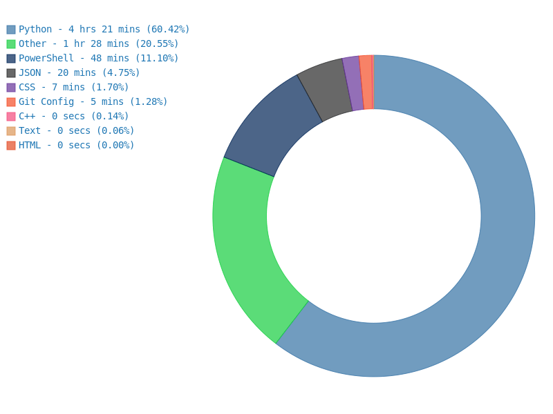

  
  

    
    
      
  

  
  <!--  -->
  
    

  <h1>
     Hey, I'm Romyo
  </h1>
  
  🌱 Currently learning **Machine Learning with Python** and **Data Structures & Algorithms**
  
  💬 Ask me about **Linux, Python, Networking, and Security**
  
  
  <picture>
    <source media="(prefers-color-scheme: dark)" srcset="https://raw.githubusercontent.com/Romyo-jit/Romyo-jit/output/github-snake-dark.svg" />
    <source media="(prefers-color-scheme: light)" srcset="https://raw.githubusercontent.com/Romyo-jit/Romyo-jit/output/github-snake.svg" />
    
  </picture>

  

### `01 /` 🌐 Socials

  
  
  
  

### `02 /` 📕 Tech Stack

  
  
  
  
  
  
  
  
    

  
  
  
  
  
  

### `03 /` ⏱️ Activity

  

